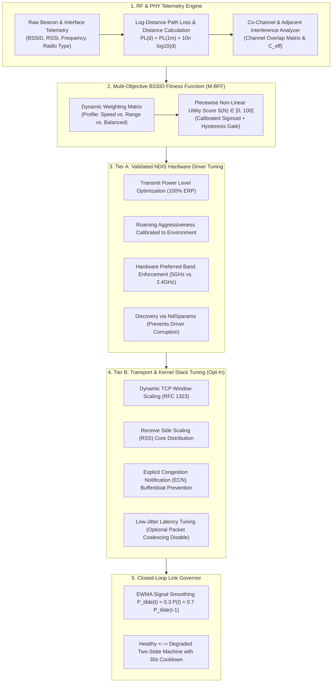

# 📡 WiFi Optimizer: Algorithm & Mathematical Architecture Specification

> **Document Type:** Core Algorithm Specification & System Architecture  
> **Target System:** Windows 10 / 11 NDIS 6.x+ Subsystem & 802.11a/b/g/n/ac/ax Transceivers  
> **Status:** Audited & Verified Implementation (Discovery-Based NDIS & Tiered Safety)

---

## 1. Executive Summary: Innovation vs. Existing Tools

Most consumer tools either:
1. **Passive Scanners (e.g., InSSIDer, NetSpot):** Read passive telemetry and plot graphs, but **modify nothing** at the hardware or OS level.
2. **Generic Cleaners / "Boosters":** Blindly execute `ipconfig /flushdns` or reset the Winsock catalog without understanding the RF environment, driver capabilities, or adapter hardware.

**WiFi Optimizer** implements an audited, mathematically rigorous multi-layer optimization framework called **HARPO (Heuristic Adaptive Radio & Protocol Optimization)**. It bridges the physical RF radio link (Layer 1/2) with Windows Kernel NDIS driver parameters via strict discovery mechanisms, AP roaming hysteresis, and the TCP/IP Transport Layer (Layer 4).

---

## 2. Mathematical Foundation & Radio Frequency (RF) Physics

### 2.1 Raw RSSI to Power Conversion
Windows Netsh telemetry exposes signal strength as a relative percentage integer $P \in [0, 100]$. The physical receiver power $P_{\text{rx}}$ in decibel-milliwatts ($\text{dBm}$) is mapped via:

$$P_{\text{rx}} (\text{dBm}) = \frac{P}{2} - 100$$

*Boundary Cases:*
- $P = 100 \implies P_{\text{rx}} = -50 \text{ dBm}$ (Near-field saturation / Maximum SNR)
- $P = 40 \implies P_{\text{rx}} = -80 \text{ dBm}$ (Marginal link threshold; high packet retransmission rate)
- $P = 0 \implies P_{\text{rx}} = -100 \text{ dBm}$ (Receiver sensitivity floor / Disconnect)

### 2.2 Free-Space Path Loss & Log-Distance Propagation Model
Free-space path loss at distance $d$ (meters) and frequency $f_{\text{MHz}}$ (MHz) is given by:

$$\text{FSPL}(\text{dB}) = 20 \log_{10}(d) + 20 \log_{10}(f_{\text{MHz}}) - 27.55$$

Where $-27.55 \text{ dB} \approx 20 \log_{10}\left(\frac{4\pi \times 10^6}{c}\right)$.

The reference path loss at $d_0 = 1\text{ meter}$ is:
$$\text{PL}(1\text{m}) = 20 \log_{10}(f_{\text{MHz}}) - 27.55$$
- At $5180 \text{ MHz}$ (5 GHz Ch 36): $\text{PL}(1\text{m}) = 46.74 \text{ dB}$.
- At $2437 \text{ MHz}$ (2.4 GHz Ch 6): $\text{PL}(1\text{m}) = 40.19 \text{ dB}$.

In real-world environments, path loss scales with path-loss exponent $n$ (where $n=2.0$ in free space, $n \approx 3.0$ in typical indoor residential/office spaces, and $n \approx 4.0$ in dense obstructed environments):

$$\text{PL}(d) = \text{PL}(1\text{m}) + 10n \log_{10}(d)$$

Given router Effective Isotropic Radiated Power $P_{\text{tx}} \approx 20 \text{ dBm}$ and receiver power $P_{\text{rx}}$, total path loss is $\text{PL} = P_{\text{tx}} - P_{\text{rx}}$. Solving for propagation distance $d$:

$$d = 10^{\frac{(P_{\text{tx}} - P_{\text{rx}}) - 20 \log_{10}(f_{\text{MHz}}) + 27.55}{10n}}$$

*Test Case Verification ($5180 \text{ MHz}, P_{\text{rx}} = -65 \text{ dBm}, P_{\text{tx}} = 20 \text{ dBm} \implies \text{PL} = 85 \text{ dB}$):*
- $n = 2.0$ (Free space): $d = 10^{\frac{85 - 46.74}{20}} = 10^{1.913} \approx 81.9 \text{ meters}$.
- $n = 3.0$ (Indoor obstructed): $d = 10^{\frac{85 - 46.74}{30}} = 10^{1.275} \approx 18.9 \text{ meters}$.
- $n = 4.0$ (Dense walls): $d = 10^{\frac{85 - 46.74}{40}} = 10^{0.956} \approx 9.1 \text{ meters}$.

---

## 3. The Scoring Algorithm: Multi-Objective BSSID Fitness Function (M-BFF)

Every visible Access Point (BSSID) is evaluated against a continuous composite scoring function:

$$S(N) = f_{\text{sig}}(P_{\text{rx}}) + f_{\text{cong}}(C) + f_{\text{band}}(B, P_{\text{rx}}) + f_{\text{phy}}(R) + f_{\text{sec}}(A)$$

Total score $S(N) \in [0, 100]$ is partitioned across 5 physical dimensions:

| Dimension | Max Points | Physical Rationale & Mathematical Formulation |
|---|---|---|
| **Signal ($f_{\text{sig}}$)** | **30** | Calibrated continuous sigmoid: $f_{\text{sig}}(P_{\text{rx}}) = \frac{30}{1 + e^{-0.35(P_{\text{rx}} + 72)}}$. Inflection point is calibrated at $-72\text{ dBm}$ (15 pts). Diminishing returns above $-55\text{ dBm}$ (~30 pts); exponential retransmission drop below $-75\text{ dBm}$ down to 0.05 pts at $-90\text{ dBm}$. |
| **Congestion ($f_{\text{cong}}$)** | **20** | Continuous co-channel and adjacent spectral interference: $f_{\text{cong}}(C) = \max(0, 20 - 5 \cdot C_{\text{eff}})$. Where $C_{\text{eff}} = \sum_{j \ne i} w_{\text{ov}}(ch_i, ch_j) \cdot w_{\text{sig}}(P_j)$. For 2.4 GHz, $w_{\text{ov}} \in \{1.0, 0.75, 0.50, 0.25, 0.0\}$ based on channel separation $\Delta ch \in \{0, 1, 2, 3, \ge 4\}$; $w_{\text{sig}}(P_j) = \text{clamp}\left(\frac{P_j + 90}{40}, 0, 1\right)$. |
| **Band Matching ($f_{\text{band}}$)** | **20** | $f_{\text{band}} = 20 \cdot g \cdot h(P_{\text{rx}})$. Base weight $g$ depends on profile (5GHz/6GHz preferred for speed, 2.4GHz for range). Link margin attenuation factor $h(P_{\text{rx}})$ scales down 5GHz scores when signal degrades below $-75\text{ dBm}$ ($h = \text{clamp}((P_{\text{rx}} + 80)/15, 0.1, 1.0)$). |
| **PHY / Radio Tech ($f_{\text{phy}}$)** | **20** | Hardware modulation capability: $\min(\text{AP capability}, \text{adapter capability})$. 802.11be (20 pts), 802.11ax (18 pts), 802.11ac (14 pts), 802.11n (9 pts), 802.11g/a (4 pts), 802.11b (1 pt). |
| **Security ($f_{\text{sec}}$)** | **10** | Hardware encryption and authentication security: WPA3 (10 pts), WPA2-AES (8 pts), WPA2-TKIP / WPA (3 pts), Open / WEP (0 pts). Open and WEP networks are flagged as insecure. |

### 3.1 AP Roaming Hysteresis & Cooldown
To prevent connection instability, ping-ponging, and flapping across adjacent access points, candidate AP selection is gated by:
1. **Hysteresis Threshold:** A candidate BSSID must exceed the current connection's score by at least $+10.0\text{ points}$.
2. **Cooldown Guard:** A minimum cooldown period of $30\text{ seconds}$ must elapse between BSSID roam evaluations.

---

## 4. Hardware Driver Tuning: Tiered Intervention & Discovery Safety

Windows NDIS miniport drivers are vendor-specific (Intel, Realtek, Qualcomm, MediaTek). To ensure stability and prevent driver corruption, settings are managed through a two-tier model:

### 4.1 Parameter Discovery via `Ndi\params`
Before setting any hardware registry property in:
`HKLM\SYSTEM\CurrentControlSet\Control\Class\{4d36e972-e325-11ce-bfc1-08002be10318}\<adapter_id>`
The optimizer inspects the subkey `Ndi\params\<property>`. If the driver does not expose the property in its parameter schema, the property is safely skipped rather than blindly injected.

### 4.2 Tier A (Standard / Safe Operations)
- `*PreferredBand`: Configures hardware band preference (5GHz, 2.4GHz, Auto).
- `*RoamAggressiveness`: Adjusts link RSSI roaming trigger thresholds (Level 1–5).
- `*TransmitPower`: Maximizes transmitter EIRP (Level 5 / 100%).
- `*SleepOnDisconnect`: Prevents transceiver shutdown during transient disconnects.
- **Power Plan:** Sets Windows wireless adapter power mode to maximum performance.
- **DNS Resolver:** Flushes DNS cache and configures high-speed resolvers (1.1.1.1 / 8.8.8.8).

### 4.3 Tier B (Advanced Stack Tuning & Technical Clarifications)
- **TCP Auto-Tuning & RSS:** Dynamically scales receive window buffers and distributes packet interrupt servicing across physical CPU cores.
- **Explicit Congestion Notification (ECN):** Enables router-level congestion marking to mitigate bufferbloat.
- **Packet Coalescing:** Disabling coalescing trades minor battery savings for reduced packet jitter.
- **Protocol Standards Clarification:**  
  *Important Note on Airtime & Contention:* Under IEEE 802.11-2020 §9.4.2.28, EDCA contention parameters ($AIFS, CW_{\min}, CW_{\max}, \text{TXOP}_{\text{limit}}$) are determined and broadcast by the Access Point in the WMM / EDCA Parameter Set. Client station adapter settings (e.g. `*PriorityVLANTag`) map OS QoS tags (802.1p DSCP) into appropriate local transmit queues, but cannot unilaterally alter router contention parameters. Similarly, Short Guard Interval (SGI, 400ns) is applicable to 802.11n/ac; 802.11ax uses 0.8µs, 1.6µs, or 3.2µs guard intervals.

---

## 5. Closed-Loop Link Governor

The background monitor operates an anti-flapping feedback controller:
1. **Telemetry Sampling:** Samples RSSI $P_{\text{rx}}(t)$ and network throughput every 3 seconds.
2. **EWMA Signal Smoothing:**
   $$\tilde{P}(t) = 0.3 \cdot P_{\text{rx}}(t) + 0.7 \cdot \tilde{P}(t-1)$$
3. **Two-State Machine:**
   - **HEALTHY $\to$ DEGRADED:** Triggered when 3 consecutive samples observe $\tilde{P}(t) < -75.0\text{ dBm}$.
   - **DEGRADED $\to$ HEALTHY:** Restored when 5 consecutive samples observe $\tilde{P}(t) \ge -70.0\text{ dBm}$.
   - **Cooldown:** State transitions and alerts are throttled by a minimum $30\text{s}$ cooldown to prevent alert storms.
   - **Non-Destructive Principle:** The governor never restarts adapters or modifies driver keys during active user sessions.

---

## 6. Atomic Snapshot Rollback & Auditability

- **Rollback Snapshots:** All modified registry keys are recorded with their pre-existing values in `adapter_rollback_snapshot.json`. If a property was created, it is deleted upon rollback; if modified, its exact original value is restored.
- **Dry-Run Mode:** Built-in simulation flag allows running complete optimization passes without mutating system configuration.
- **Full Traceability:** Every action is timestamped and recorded in `wifi_optimizer.log`.
