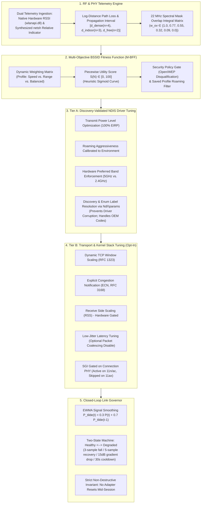

# 📡 WiFi Optimizer: Algorithm & Mathematical Architecture Specification

> **Document Type:** Core Algorithm Specification & System Architecture  
> **Target System:** Windows 10 / 11 NDIS 6.x+ Subsystem & 802.11a/b/g/n/ac/ax Transceivers  
> **Status:** Audited & Verified Implementation (Hardware Native RSSI, Discovery-Based NDIS & Tiered Safety)

---

## 1. Executive Summary & Scope

Most consumer tools either:
1. **Passive Scanners (e.g., InSSIDer, NetSpot):** Read passive telemetry and plot graphs, but **modify nothing** at the hardware or OS level.
2. **Generic Cleaners / "Boosters":** Blindly execute `ipconfig /flushdns` or reset the Winsock catalog without understanding the RF environment, driver capabilities, or adapter hardware.

**WiFi Optimizer** implements an audited, mathematically grounded multi-layer optimization framework called **HARPO (Heuristic Adaptive Radio & Protocol Optimization)**. It bridges the physical RF radio link (Layer 1/2) with Windows Kernel NDIS driver parameters via discovery mechanisms, true security policy gating, AP roaming hysteresis, and the TCP/IP Transport Layer (Layer 4).

---

## 2. Mathematical Foundation & Radio Frequency (RF) Physics

### 2.1 Hardware Native RSSI vs. Synthesized Netsh Indicator
Wi-Fi receivers evaluate radio power via Received Signal Strength Indication (RSSI).
- **Physical Hardware RSSI (Preferred):** Obtained directly from the NDIS miniport driver via the Windows Native Wi-Fi API (`wlanapi.dll` $\to$ `WlanGetNetworkBssList` $\to$ `lRssi`). This is an integer decibel-milliwatt ($\text{dBm}$) measurement with typical instrument accuracy of $\pm 1.5\text{ dB}$.
- **Synthesized Relative Signal Quality (Fallback):** Windows Netsh telemetry exposes signal quality as a dimensionless relative integer $P \in [0, 100]$. The netsh heuristic formula maps this as:
  $$P_{\text{rx}} (\text{dBm}) = \frac{P}{2} - 100$$
  *Important Caveat:* This formula is a vendor-synthesized linear approximation, **not a laboratory-calibrated power measurement**. Real transceivers exhibit non-linear ADC quantization and vendor-specific AGC mappings, carrying an inherent measurement uncertainty of $\pm 6\text{ dB}$.

### 2.2 Log-Distance Path Loss & Propagation Range Intervals
Free-space path loss at distance $d$ (meters) and frequency $f_{\text{MHz}}$ (MHz) follows the Friis transmission equation:

$$\text{FSPL}(\text{dB}) = 20 \log_{10}(d) + 20 \log_{10}(f_{\text{MHz}}) - 27.55$$

Where $-27.55 \text{ dB} \approx 20 \log_{10}\left(\frac{4\pi \times 10^6}{c}\right)$.

The 1-meter reference path loss $\text{PL}(1\text{m})$ is:
$$\text{PL}(1\text{m}) = 20 \log_{10}(f_{\text{MHz}}) - 27.55$$
- At $5180 \text{ MHz}$ (5 GHz Ch 36): $\text{PL}(1\text{m}) = 46.74 \text{ dB}$.
- At $2437 \text{ MHz}$ (2.4 GHz Ch 6): $\text{PL}(1\text{m}) = 40.19 \text{ dB}$.

In real-world environments, path loss scales with path-loss exponent $n$:
$$\text{PL}(d) = \text{PL}(1\text{m}) + 10n \log_{10}(d)$$

Given router Effective Isotropic Radiated Power $P_{\text{tx}} \approx 20 \text{ dBm}$ and receiver power $P_{\text{rx}}$, total path loss is $\text{PL} = P_{\text{tx}} - P_{\text{rx}}$. Solving for propagation distance $d$:

$$d = 10^{\frac{(P_{\text{tx}} - P_{\text{rx}}) - 20 \log_{10}(f_{\text{MHz}}) + 27.55}{10n}}$$

*Uncertainty and Range Intervals:*  
Because indoor RF propagation is affected by multipath reflections, wall materials, and unknown router antenna gains, the tool displays an **environmental propagation interval** rather than a misleading single decimal:
- $n = 2.0$ (Ideal Free-Space Line-of-Sight Upper Bound)
- $n = 3.0$ (Typical Indoor Residential / Drywall)
- $n = 4.0$ (Dense Concrete / Multi-Wall Obstruction Lower Bound)

*Reference Calculation ($5180 \text{ MHz}, P_{\text{rx}} = -65 \text{ dBm}, P_{\text{tx}} = 20 \text{ dBm} \implies \text{PL} = 85 \text{ dB}$):*
- Free Space ($n = 2.0$): $d = 10^{38.26 / 20} \approx 81.9 \text{ meters}$ (Theoretical unattenuated LOS maximum).
- Indoor Obstacle ($n = 3.0$): $d = 10^{38.26 / 30} \approx 18.9 \text{ meters}$.
- Dense Concrete ($n = 4.0$): $d = 10^{38.26 / 40} \approx 9.1 \text{ meters}$.
- **Reported Range:** $9.1\text{ m} - 18.9\text{ m}$ (Indoor Obstacle Range) [Uncalibrated $\pm 6\text{ dB}$].

---

## 3. The Scoring Algorithm: Multi-Objective BSSID Fitness Function (M-BFF)

Every visible Access Point (BSSID) is evaluated against a composite fitness function:

$$S(N) = f_{\text{sig}}(P_{\text{rx}}) + f_{\text{cong}}(C) + f_{\text{band}}(B, P_{\text{rx}}) + f_{\text{phy}}(R) + f_{\text{sec}}(A)$$

Total score $S(N) \in [0, 100]$ evaluates 5 physical dimensions:

| Dimension | Max Points | Formulation & Scientific Rationale |
|---|---|---|
| **Signal ($f_{\text{sig}}$)** | **30** | Heuristic continuous sigmoid: $f_{\text{sig}}(P_{\text{rx}}) = \frac{30}{1 + e^{-0.35(P_{\text{rx}} + 72)}}$. The parameters ($k=0.35, x_0=-72\text{ dBm}$) model typical 802.11 receiver sensitivity cliffs where Bit Error Rate (BER) spikes exponentially below $-75\text{ dBm}$. Inflection point is at $-72\text{ dBm}$ (15 pts); saturation occurs above $-55\text{ dBm}$ (~30 pts). |
| **Congestion ($f_{\text{cong}}$)** | **20** | Continuous spectral interference penalized by BSS Load ($u \in [0, 1]$): $f_{\text{cong}}(C) = \max(0, 20 - 5 \cdot C_{\text{eff}}) \cdot (1 - u)$. Where $C_{\text{eff}} = \sum_{j \ne i} w_{\text{ov}}(ch_i, ch_j) \cdot w_{\text{sig}}(P_j)$. Overlap weight $w_{\text{ov}}$ follows the 22 MHz channel spectral mask overlap integral: $w_{\text{ov}} = \max\left(0, \text{round}\left(1 - \frac{|\Delta ch| \times 5}{22}, 2\right)\right)$ ($\Delta ch=0 \to 1.0, 1 \to 0.77, 2 \to 0.55, 3 \to 0.32, 4 \to 0.09, \ge 5 \to 0.0$). $w_{\text{sig}}(P_j) = \text{clamp}\left(\frac{P_j + 90}{40}, 0, 1\right)$. |
| **Band Matching ($f_{\text{band}}$)** | **20** | $f_{\text{band}} = 20 \cdot g \cdot h(P_{\text{rx}})$. Base weight $g$ reflects profile priorities. Link margin attenuation $h(P_{\text{rx}})$ scales down high-frequency bands when signal approaches sensitivity floor ($h = \text{clamp}((P_{\text{rx}} + 80)/15, 0.1, 1.0)$ for 5/6 GHz). |
| **PHY / Radio Tech ($f_{\text{phy}}$)** | **20** | Modulation efficiency: $\min(\text{AP capability}, \text{adapter capability})$. 802.11be (20 pts), 802.11ax (18 pts), 802.11ac (14 pts), 802.11n (9 pts), 802.11g/a (4 pts), 802.11b (1 pt). |
| **Security ($f_{\text{sec}}$)** | **10** | Hardware cipher offload: WPA3 (10 pts), WPA2-AES (8 pts), WPA2-TKIP / WPA (3 pts), Open / WEP (0 pts). |

### 3.1 True Security Policy Gating
Setting $f_{\text{sec}} = 0$ is not sufficient on its own, because an unencrypted network could still score ~90 points from the other terms. The optimizer therefore enforces **Policy Eligibility Gating**:
- **Hard Security Gate:** By default (`allow_insecure_networks = False`), Open (unencrypted plaintext) and WEP (broken, deprecated RC4 cipher) networks are marked `is_eligible = False` and are disqualified from selection as the recommended connection.
- **Saved Profile Filter:** When `require_saved_profile = True`, the optimizer restricts automatic AP switching recommendations exclusively to SSIDs already stored in the Windows Wi-Fi profile database (`netsh wlan show profiles`).

### 3.2 AP Roaming Hysteresis & Cooldown
To prevent connection flapping between adjacent access points:
1. **Hysteresis Threshold:** A candidate BSSID must exceed the current connection's score by at least $+10.0\text{ points}$.
2. **Cooldown Guard:** A minimum cooldown period of $30\text{ seconds}$ must elapse between BSSID roam recommendations.

---

## 4. Hardware Driver Tuning: Tiered Intervention & Discovery Safety

Windows NDIS miniport drivers are vendor-specific. The optimizer strictly segregates operations:

### 4.1 Parameter Discovery & Enum Label Resolution (`Ndi\params`)
Before modifying any registry property under:
`HKLM\SYSTEM\CurrentControlSet\Control\Class\{4d36e972-e325-11ce-bfc1-08002be10318}\<adapter_id>`
The optimizer queries `Ndi\params\<keyword>`:
- **Existence Check:** If the driver does not expose the keyword, the property is skipped.
- **Enum Label Parsing:** Reads `(code, label)` pairs under `enum`. For example, with `*MIMOPowerSave`, Intel drivers map code `"0"` to Auto SMPS and code `"3"` to "No SMPS" (Disable). The optimizer parses the human-readable label to match the true intended code rather than writing an assumed numeric value.
- **Numeric Range Clamping:** Reads `min` and `max` for integer properties to ensure injected values remain within driver bounds.
- **Driver Reinitialization Notice:** Modifying advanced NDIS parameters causes the miniport driver to briefly reinitialize radio firmware.

### 4.2 Tier A (Standard / Safe Operations)
- `*PreferredBand`: Hardware band steering (5GHz, 2.4GHz, Auto).
- `*RoamAggressiveness`: RSSI roaming trigger thresholds (Level 1–5).
- `*TransmitPower`: Maximizes transmitter EIRP (Level 5 / 100%).
- `*SleepOnDisconnect`: Prevents transceiver shutdown during transient disconnects.
- **Power Plan:** Sets Windows wireless adapter power scheme to maximum performance via `powercfg`.
- **DNS Resolver:** Flushes DNS resolver cache and configures high-speed resolvers (1.1.1.1 / 8.8.8.8).

### 4.3 Tier B (Advanced Stack Tuning & Standards Clarifications)
- **QoS Frame Tagging (`*PriorityVLANTag = 3`):** Configures the NDIS miniport to insert IEEE 802.1p User Priority (Layer 2) and 802.1Q VLAN tags into outbound Ethernet frames. *Note:* This operates at Layer 2 and does not map IP DSCP (Layer 3) headers into EDCA queues on its own.
- **Short Guard Interval (SGI, 400ns):** Gated by the **negotiated PHY mode** of the active connection:
  - Applied if associated on 802.11n (HT) or 802.11ac (VHT), even on Wi-Fi 6 adapters.
  - Skipped if associated on 802.11ax (HE) or 802.11be (EHT), where guard intervals ($0.8\ \mu\text{s}, 1.6\ \mu\text{s}, 3.2\ \mu\text{s}$) are governed by the AP's HE Operation element.
- **TCP Receive Window Auto-Tuning:** Normal (RFC 1323 BDP scaling up to 16 MB).
- **Explicit Congestion Notification (ECN, RFC 3168):** Prevents packet drops on congestion-capable routers.
- **Receive Side Scaling (RSS):** Gated by a hardware capability check (`Get-NetAdapterRss`).
- **Contention Standards Note:** Under IEEE 802.11 standards, channel contention parameters ($AIFS, CW_{\min}, CW_{\max}, \text{TXOP}_{\text{limit}}$) are determined and broadcast by the Access Point in the WMM/EDCA Parameter Set. Client settings prioritize local transmission queues, but cannot unilaterally alter router contention parameters.

---

## 5. Closed-Loop Link Governor

The background monitor operates an anti-flapping feedback controller:
1. **Telemetry Sampling:** Samples RSSI $P_{\text{rx}}(t)$ and throughput every 3 seconds.
2. **EWMA Signal Smoothing:**
   $$\tilde{P}(t) = 0.3 \cdot P_{\text{rx}}(t) + 0.7 \cdot \tilde{P}(t-1)$$
3. **State Machine Rules:**
   - **HEALTHY $\to$ DEGRADED:** Triggered when 3 consecutive samples observe $\tilde{P}(t) < -75.0\text{ dBm}$ **OR** a steep gradient drop occurs: $\nabla P \le -15.0\text{ dB}$ over $\le 12\text{ seconds}$.
   - **DEGRADED $\to$ HEALTHY:** Restored when 5 consecutive samples observe $\tilde{P}(t) \ge -70.0\text{ dBm}$ and the $30\text{s}$ cooldown has elapsed.
   - **Non-Destructive Invariant:** The governor loop NEVER modifies hardware registry keys or restarts network adapters mid-session.

---

## 6. Atomic Snapshot Rollback & Benchmarking

- **Atomic Rollback Snapshots:** All modified registry keys are recorded in `adapter_rollback_snapshot.json` with their pre-existing states. Upon rollback, previous values are restored and created keys are deleted.
- **Dry-Run Mode:** Built-in simulation flag allows running complete optimization passes without mutating system configuration.
- **Benchmark Harness (`scripts/benchmark_harness.py`):** Provides reproducible automated verification of RTT latency, jitter (standard deviation), packet loss, and native vs. netsh RSSI reporting.
