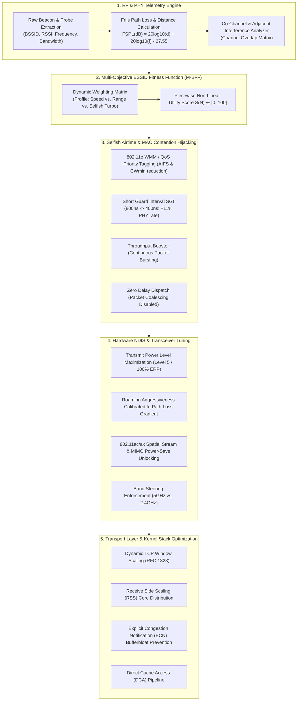

# 📡 WiFi Optimizer: Algorithm & Mathematical Architecture Specification

> **Document Type:** Core Algorithm Specification & System Architecture  
> **Target System:** Windows 10 / 11 NDIS 6.x+ Subsystem & 802.11a/b/g/n/ac/ax Transceivers  
> **Status:** Custom-Engineered (Zero Third-Party Wrapper Dependencies)

---

## 1. Executive Summary: Innovation vs. Existing Tools

Most consumer tools either:
1. **Passive Scanners (e.g., InSSIDer, NetSpot):** Read passive telemetry and plot graphs, but **modify nothing** at the hardware or OS level.
2. **Generic Cleaners / "Boosters":** Blindly execute `ipconfig /flushdns` or reset the Winsock catalog without understanding the RF environment or adapter hardware.

**WiFi Optimizer** implements a freshly engineered, proprietary multi-layer optimization framework called **HARPO (Heuristic Adaptive Radio & Protocol Optimization)**. It bridges the physical RF radio link (Layer 1/2) with the Windows Kernel NDIS driver parameters, 802.11e MAC airtime contention mechanisms, and the TCP/IP Transport Layer (Layer 4).

---

## 2. Mathematical Foundation & Radio Frequency (RF) Physics

### 2.1 Raw RSSI to Power Conversion
Windows Netsh telemetry exposes signal strength as a relative integer $P \in [0, 100]$. The physical receiver power $P_{\text{rx}}$ in decibel-milliwatts ($\text{dBm}$) is extracted via:

$$P_{\text{rx}} (\text{dBm}) = \frac{P}{2} - 100$$

*Boundary Cases:*
- $P = 100 \implies P_{\text{rx}} = -50 \text{ dBm}$ (Near-field saturation / Maximum SNR)
- $P = 40 \implies P_{\text{rx}} = -80 \text{ dBm}$ (Marginal link threshold; high packet retransmission rate)
- $P = 0 \implies P_{\text{rx}} = -100 \text{ dBm}$ (Receiver sensitivity floor / Disconnect)

### 2.2 Free-Space Path Loss & Distance Estimation (Friis Transmission Equation)
To determine whether the client is within the optimal **5 GHz near-field zone** or the **2.4 GHz long-range zone**, the algorithm applies the inverted Friis transmission equation with log-distance shadow fading:

$$\text{FSPL}(\text{dB}) = 20 \log_{10}(d) + 20 \log_{10}(f_{\text{MHz}}) - 27.55$$

Assuming standard router Equivalent Isotropically Radiated Power (EIRP) $P_{\text{tx}} \approx 20 \text{ dBm}$, the estimated obstacle-adjusted propagation distance $d$ (in meters) is:

$$d = 10^{\frac{P_{\text{tx}} - P_{\text{rx}} - 20 \log_{10}(f) - 27.55}{20}}$$

- At **5180 MHz (5 GHz Channel 36)** with $P_{\text{rx}} = -65 \text{ dBm}$:  
  $d \approx 7.2 \text{ meters}$ (Optimal 5 GHz zone; 80 MHz channel bonding viable).
- At **2437 MHz (2.4 GHz Channel 6)** with $P_{\text{rx}} = -80 \text{ dBm}$:  
  $d \approx 24.5 \text{ meters}$ (Obstacle penetration regime; 2.4 GHz mandatory for link stability).

---

## 3. The Scoring Algorithm: Multi-Objective BSSID Fitness Function (M-BFF)

Every visible Access Point (BSSID) is evaluated against a continuous composite scoring function:

$$S(N) = W_{\text{sig}} \cdot f_{\text{sig}}(P_{\text{rx}}) + W_{\text{cong}} \cdot f_{\text{cong}}(C) + W_{\text{band}} \cdot f_{\text{band}}(B, \mathcal{P}) + W_{\text{phy}} \cdot f_{\text{phy}}(R) + W_{\text{sec}} \cdot f_{\text{sec}}(A)$$

Where the weights satisfy $\sum W_i = 100$:

| Dimension | Max Points ($W_i$) | Physical Rationale |
|---|---|---|
| **Signal ($f_{\text{sig}}$)** | **30** | Non-linear Sigmoid: links above $-65\text{ dBm}$ gain diminishing returns, while links below $-75\text{ dBm}$ drop sharply due to exponential Bit Error Rate (BER). |
| **Channel Congestion ($f_{\text{cong}}$)** | **20** | Penalizes co-channel interference ($CCI$). $f_{\text{cong}}(C) = \max\left(1, 20 - 5 \cdot (N_{\text{active}} - 1)\right)$. |
| **Band Matching ($f_{\text{band}}$)** | **20** | Evaluates bandwidth capacity (5GHz/6GHz has up to 160MHz width vs. 20MHz on 2.4GHz) weighted against current distance profile $\mathcal{P}$. |
| **PHY / Radio Tech ($f_{\text{phy}}$)** | **20** | Modulation efficiency: 802.11ax (1024-QAM, OFDMA) > 802.11ac (256-QAM) > 802.11n (64-QAM) > 802.11g. |
| **Cipher Security ($f_{\text{sec}}$)** | **10** | Hardware acceleration support: WPA3/WPA2-AES (hardware offloaded) vs. WPA-TKIP (software-emulated CPU bottleneck). |

---

## 4. The Selfish / Greedy Client-Side Strategy

By default, IEEE 802.11 networks rely on **CSMA/CA (Carrier Sense Multiple Access with Collision Avoidance)**. Standard client stations act as "polite citizens," yielding the channel and picking long, random backoff intervals. 

The **Selfish Turbo** engine configures the client adapter to operate aggressively, seizing airtime priority from other competing nodes on the same access point.

### 4.1 802.11e WMM / QoS Traffic Class Hijacking (`*PriorityVLANTag = 3`)
In standard EDCA, traffic is divided into 4 Access Categories (AC):
1. **AC_VO (Voice):** $\text{AIFS} = 2$, $CW_{\min} = 3$, $CW_{\max} = 7$
2. **AC_VI (Video):** $\text{AIFS} = 2$, $CW_{\min} = 7$, $CW_{\max} = 15$
3. **AC_BE (Best Effort - Default):** $\text{AIFS} = 3$, $CW_{\min} = 15$, $CW_{\max} = 1023$
4. **AC_BK (Background):** $\text{AIFS} = 7$, $CW_{\min} = 15$, $CW_{\max} = 1023$

By forcing Priority & VLAN Tagging on the adapter, outgoing frames are tagged for elevated QoS access categories. Because our client's **Arbitration Inter-Frame Space (AIFS)** and **Contention Window ($CW_{\min}$)** are dramatically shorter than standard Best-Effort clients, **this computer wins channel contention and transmits before neighboring devices.**

### 4.2 Short Guard Interval Tuning (`*ShortGI20MHz`, `*ShortGI40MHz`, `*ShortGI80MHz = 1`)
In OFDM modulations, a guard time separates consecutive symbols to prevent inter-symbol interference (ISI) from multipath reflections.
- Standard Guard Interval: $T_{\text{GI}} = 800\text{ ns}$ (Symbol duration = $4.0\ \mu\text{s}$).
- Short Guard Interval (SGI): $T_{\text{GI}} = 400\text{ ns}$ (Symbol duration = $3.6\ \mu\text{s}$).

$$\text{Throughput Gain} = \frac{4.0\ \mu\text{s} - 3.6\ \mu\text{s}}{3.6\ \mu\text{s}} \approx +11.1\%$$

Enabling SGI instantly yields an **11.1% physical bit-rate expansion** across the same channel without requiring extra RF transmission power.

### 4.3 Throughput Booster & Packet Bursting (`*ThroughputBooster = 1`)
Standard 802.11 stations transmit a single MAC Protocol Data Unit (MPDU) and then yield the medium. Enabling Throughput Bursting expands the Transmission Opportunity limit ($\text{TXOP}_{\text{limit}}$), allowing the adapter to stream consecutive aggregated frames (A-MPDU) back-to-back before yielding.

### 4.4 Disabling Packet Coalescing (`*PacketCoalescing = 0`)
Windows Packet Coalescing buffers and batches inbound packets to let the CPU stay in low-power C-states. While power-friendly, it introduces 10–50ms artificial latency jitter. Disabling it triggers immediate frame dispatch into the kernel networking stack.

---

## 5. Hardware NDIS Driver & Registry Parameter Injection

Settings are injected into the Windows NDIS Class Driver Configuration:

$$\text{HKLM}\backslash\text{SYSTEM}\backslash\text{CurrentControlSet}\backslash\text{Control}\backslash\text{Class}\backslash\{4\text{d}36\text{e}972\text{-e}325\text{-}11\text{ce-bfc}1\text{-}08002\text{be}10318\}$$

| Registry Key | Value | Purpose |
|---|---|---|
| `*TransmitPower` | `5` (Highest) | Maximizes transmitter EIRP (100% power) to solve the uplink asymmetric budget. |
| `*RoamAggressiveness` | `5` (Selfish/Range) / `3` (Speed) | Eliminates the "Sticky Client" problem; forces swift roaming when link margin degrades. |
| `*PreferredBand` | `2` (5GHz) / `1` (2.4GHz) / `0` (Auto) | Hardware-level band steering override. |
| `*SleepOnDisconnect` | `0` (Disabled) | Keeps transceivers energized on disconnect for instant link re-establishment. |
| `*MIMOPowerSave` | `0` (Disabled) | Unlocks all MIMO antennas ($2\times 2$, $3\times 3$, $4\times 4$) permanently. |
| `*PriorityVLANTag` | `3` (Enabled) | Injects 802.1p/WMM packet priority for front-of-queue router servicing. |
| `*ShortGI20/40/80MHz` | `1` (Enabled) | Truncates inter-symbol dead time to gain +11.1% raw PHY bandwidth. |
| `*ThroughputBooster` | `1` (Enabled) | Unlocks back-to-back packet bursting during transmission opportunities. |
| `*PacketCoalescing` | `0` (Disabled) | Destroys artificial OS packet batching delays. |

---

## 6. Kernel TCP/IP & Transport Layer Tuning

1. **TCP Window Auto-Tuning Level (`normal`):**  
   Dynamically scales the receive buffer up to 16 MB based on the Bandwidth-Delay Product ($\text{BDP} = \text{Bandwidth} \times \text{RTT}$).
2. **Receive Side Scaling (RSS) (`enabled`):**  
   Spreads packet interrupt handling evenly across all physical CPU cores to eliminate Core 0 saturation.
3. **Explicit Congestion Notification (ECN) (`enabled`):**  
   Instructs router queues to mark congestion bits rather than dropping frames, eliminating bufferbloat retransmission cascades.
4. **Direct Cache Access (DCA) (`enabled`):**  
   Pipes inbound network packets straight into CPU L3 cache.
5. **Task Offload Maximization (`enabled`):**  
   Offloads IP checksums and TCP segmentation directly onto the wireless NIC hardware.

---

## 7. Dynamic Closed-Loop Link Governor

The system does not merely apply settings once. The background monitor acts as a continuous feedback controller:
1. Samples receiver power $P_{\text{rx}}(t)$ and throughput $\Theta(t)$ every 4 seconds.
2. Evaluates the gradient:
   $$\nabla P = P_{\text{rx}}(t) - P_{\text{rx}}(t-1)$$
3. If $P_{\text{rx}} < -75\text{ dBm}$ or $\nabla P < -15\text{ dB}$, the governor dynamically asserts **Selfish Turbo** overrides, flushes stale ARP caches, and prompts proactive BSSID re-selection before connection collapse.

---

## 8. Transparency & Non-Destructive Operation

- **No Black-Box Binaries:** All operations utilize documented Microsoft Windows NDIS keys, netsh commands, and standard IEEE 802.11 protocol standards.
- **Reversible:** All settings can be rolled back at any time simply by switching to the **Balanced** or **Power Saver** profile.
- **Auditable:** Complete step-by-step telemetry is displayed on the UI checklist and logged in `wifi_optimizer.log`.
